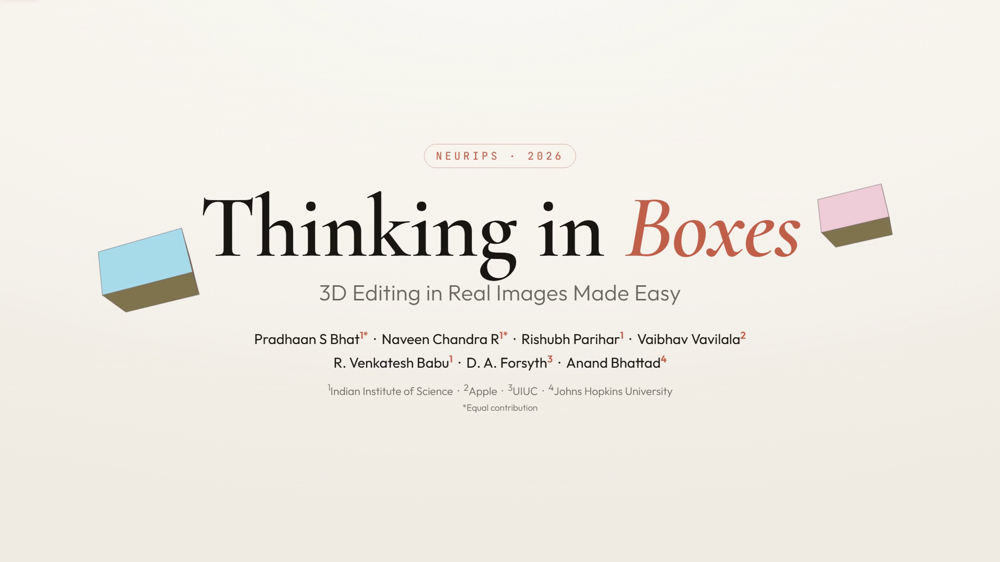
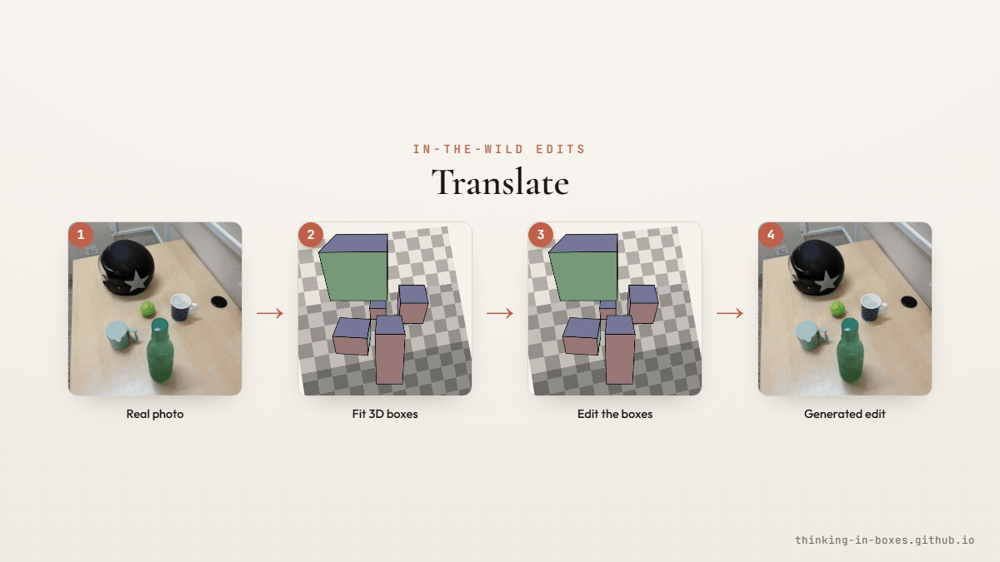

<div align="center">

# Thinking in Boxes: 3D Editing in Real Images Made Easy

### NeurIPS 2026



[**Pradhaan S Bhat**](https://pradhaansbhat.github.io/)<sup>1</sup><sup>∗</sup> · [**Naveen Chandra R**](https://www.linkedin.com/in/naveen-chandra-r-7230aa192)<sup>1</sup><sup>∗</sup> · [**Rishubh Parihar**](https://rishubhpar.github.io/)<sup>1</sup> · [**Vaibhav Vavilala**](https://www.linkedin.com/in/vaibhav-vavilala)<sup>2</sup> · [**R. Venkatesh Babu**](https://cds.iisc.ac.in/faculty/venky/)<sup>1</sup> · [**D. A. Forsyth**](http://luthuli.cs.uiuc.edu/~daf/)<sup>3</sup> · [**Anand Bhattad**](https://anandbhattad.github.io/)<sup>4</sup>

<sup>1</sup> Indian Institute of Science &nbsp;·&nbsp; <sup>2</sup> Apple &nbsp;·&nbsp; <sup>3</sup> UIUC &nbsp;·&nbsp; <sup>4</sup> Johns Hopkins University

<sup>∗</sup> Equal Contribution

[](https://arxiv.org/abs/2606.20556)
[](https://thinking-in-boxes.github.io)
[](https://huggingface.co/pradhaansbhat/Thinking-In-Boxes)
[](https://huggingface.co/datasets/pradhaansbhat/Thinking-In-Boxes)
[](#-demo)

</div>

---

## 📚 Abstract

Text and 2D-conditioning interfaces provide weak, ambiguous control over spatial
transformations in image editing — particularly under large object motions and
camera changes. Prior work has used 3D primitives such as boxes, but only as loose
conditioning signals indicating approximate object location rather than specifying
the transformation.

We instead use **3D boxes as structured specifications**: the user provides the input
and output boxes of the edit, casting editing as a well-posed geometry problem. This
"thinking in boxes" interface, where each box face is color-coded to convey 3D
orientation, gives precise control over translation, rotation, scaling, and viewpoint
changes in real images while preserving scene and object identity, and recovering
previously unseen object regions. To ground transformations in scene appearance, we
introduce a **depth-aligned planar floor** as a global reference frame, shaded with
depth-aware cues.

Conditioned on this structure, an image generator produces consistent results under
large transformations. Trained in two stages — on synthetic multi-object scenes and a
small set of real-world videos from Objectron — the system generalizes to complex,
in-the-wild real images. Our method operates directly on real photographs and
substantially **outperforms recent state-of-the-art methods** on large 3D edits.

<div align="center">
  
</div>

---

## 🗺️ Navigation

| Section | Description |
| :--- | :--- |
| [🛠️ Configuration](#%EF%B8%8F-configuration) | Install and set up the environment |
| [⚙️ Usage](#%EF%B8%8F-usage) | Train and run inference |
| [🤗 Demo](#-demo) | Launch the interactive Gradio demo |
| [🤝 Citation](#-citation) | Cite our work |

---

## 🛠️ Configuration

### 1. Install uv

```bash
curl -LsSf https://astral.sh/uv/install.sh | sh
```

See the [uv installation guide](https://docs.astral.sh/uv/getting-started/installation/#standalone-installer) for other platforms.

### 2. Set up the environment

```bash
uv sync
```

### 3. Hugging Face token

Some model and dataset repositories are gated. Create an access token
([guide](https://huggingface.co/docs/hub/en/security-tokens)) and set `HF_TOKEN`
before training or inference.

<details>
<summary>📦 Dependency tree (<code>uv tree</code>)</summary>

```tree
thinking-in-boxes v0.1.0
├── accelerate v1.15.0
│   ├── huggingface-hub v1.33.0
│   │   ├── click v8.5.0
│   │   ├── filelock v4.0.12
│   │   ├── fsspec v2026.7.0
│   │   ├── hf-xet v1.7.0
│   │   ├── httpx v0.28.1
│   │   │   ├── anyio v4.15.1
│   │   │   │   ├── idna v3.20
│   │   │   │   └── typing-extensions v4.16.0
│   │   │   ├── certifi v2026.7.22
│   │   │   ├── httpcore v1.0.9
│   │   │   │   ├── certifi v2026.7.22
│   │   │   │   └── h11 v0.16.0
│   │   │   └── idna v3.20
│   │   ├── packaging v26.3
│   │   ├── pyyaml v6.0.3
│   │   ├── tqdm v4.70.1
│   │   └── typing-extensions v4.16.0
│   ├── numpy v2.5.3
│   ├── packaging v26.3
│   ├── psutil v7.2.2
│   ├── pyyaml v6.0.3
│   ├── safetensors v0.8.0
│   └── torch v2.14.1+cu130
│       ├── cuda-toolkit[...] v13.0.3.0
│       ├── jinja2 v3.1.6
│       ├── networkx v3.7
│       ├── nvidia-cudnn-cu13 v9.24.0.43
│       ├── setuptools v84.0.0
│       ├── sympy v1.14.0
│       ├── triton v3.8.0
│       └── typing-extensions v4.16.0
├── datasets v5.1.0
├── diffusers v0.41.0
├── einops v0.8.2
├── gradio v6.30.0
│   ├── fastapi v0.143.1
│   │   └── pydantic v2.13.5
│   ├── gradio-client v2.7.2
│   ├── pillow v12.3.0
│   └── uvicorn v0.54.0
├── peft v0.21.2
│   └── transformers v5.19.0
├── prodigyopt v1.1.2
├── torch v2.14.1+cu130 (*)
├── torchvision v0.29.1+cu130
├── transformers v5.19.0 (*)
├── utils3d v1.7
│   ├── moderngl v5.13.0
│   └── scipy v1.18.1
├── vis4d v0.0
│   ├── pydantic v2.13.5 (*)
│   ├── scalabel v0.3.1
│   ├── torch v2.14.1+cu130 (*)
│   └── torchvision v0.29.1+cu130 (*)
├── vis4d-cuda-ops v0.0.0
│   └── ninja v1.13.2
└── wandb v0.30.0

(*) Package tree already displayed. Run `uv tree` for the full, unabridged graph.
```

</details>

---

## ⚙️ Usage

All source code lives under `src/thinking_in_boxes`.

> **Tip:** Code blocks wrapped in `##########` markers indicate our changes on top of
> the original diffusers code, in `src/thinking_in_boxes/pipelines/pipeline_flux_kontext.py`
> and `src/thinking_in_boxes/train.py`.

### 📊 Data pipeline

Code and instructions for rendering your own data live under
`src/thinking_in_boxes/data/`. See the `README.md` there for details.

### 🔥 Training

Training runs in **two stages** — Stage 1 on purely synthetic data, Stage 2 on a mix of
synthetic data and a real subset from Objectron.

1. `cd src/thinking_in_boxes`
2. Set `HF_TOKEN` and `WANDB_TOKEN` in `scripts/train.sh`.
3. (Optional) Configure Accelerate for your machine: `accelerate config`.
4. Launch: `bash scripts/train.sh`.

The dataset downloads automatically on first run (preparation may take a while).
Checkpoints are saved under `Thinking-In-Boxes-R32-Stage<n>`.

### ❄️ Inference

1. `cd src/thinking_in_boxes`
2. Set `HF_TOKEN` in `scripts/inference.sh`.
3. Configure `REFERENCE_IMAGE`, `SOURCE_PRIMITIVE`, `TARGET_PRIMITIVE`, and `SAVE_DIR`.
4. Run: `bash scripts/inference.sh`.

---

## 🤗 Demo

### (Optional) Set up WildDet3D for auto-detection

The demo can auto-fit 3D boxes to objects using
[WildDet3D](https://github.com/allenai/WildDet3D). This step is optional; you can always
place boxes by hand.

```bash
git clone --recurse-submodules https://github.com/allenai/WildDet3D.git
export WILDDET3D_REPO="$(cd WildDet3D && pwd)"
```

> **Notes**
> - Detected boxes may not be perfectly accurate — we recommend refining them manually.
> - The first detection run sets up WildDet3D automatically and may take some time.
> - The editor starts with one 3D box; delete it (select it and press `−` or `Delete`) if not needed.
> - We recommend **≈48 GB VRAM** total to run the full pipeline + detector.

### Run the Gradio demo

```bash
cd src/thinking_in_boxes
uv run demo.py
```

> **Note:** Set `HF_TOKEN` and `HF_HOME` or have `black-forest-labs/FLUX.1-Kontext-dev` downloaded.


### Using the editor

1. Check the **left rail** for shortcuts and hover over icons for tooltips. A little
   familiarity with the UI makes editing much easier.
2. Fit boxes to the scene, then click the **bookmark** button to set the *source* boxes.
   Edit the boxes into the *target* pose, then click **"Grab image + boxes from editor"**.
3. Use individual edit modes, or **Free** mode, depending on your need:

   | Key   | Mode        |
   | :---- | :---------- |
   | `T`   | Translate   |
   | `R`   | Rotate      |
   | `S`   | Scale       |
   | `C`   | Camera      |
   | Floor | Edit floor  |
   | Free  | T · R · S · C |

4. **Box face colors indicate 3D orientation**:

   | Color  | Face   |
   | :----- | :----- |
   | Red    | Front  |
   | Cyan   | Left   |
   | Green  | Back   |
   | Pink   | Right  |
   | Blue   | Top    |
   | Yellow | Bottom |

5. We recommend the default **512×512** resolution, resize your images accordingly for best results.
6. For a fullscreen 3D editor, open `box-editor.html` directly and export the boxes manually.
7. **Pro tip:** Export box layouts as JSON to re-import and continue editing later.

---

## 🙏 Acknowledgements

We thank the contributors of the [diffusers](https://github.com/huggingface/diffusers)
library for their open-source work.

---

## 🤝 Citation

If you find our work useful, please consider citing:

```bibtex
@misc{bhat2026thinkingboxes3dediting,
  title         = {Thinking in Boxes: 3D Editing in Real Images Made Easy},
  author        = {Pradhaan S Bhat and Naveen Chandra R and Rishubh Parihar and Vaibhav Vavilala and R. Venkatesh Babu and D. A. Forsyth and Anand Bhattad},
  year          = {2026},
  eprint        = {2606.20556},
  archivePrefix = {arXiv},
  primaryClass  = {cs.CV},
  url           = {https://arxiv.org/abs/2606.20556}
}
```
